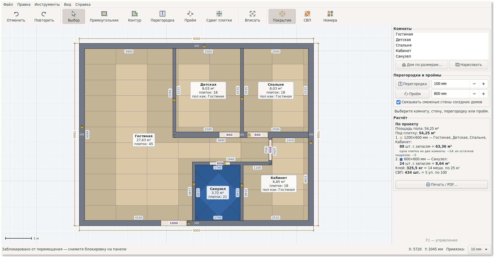
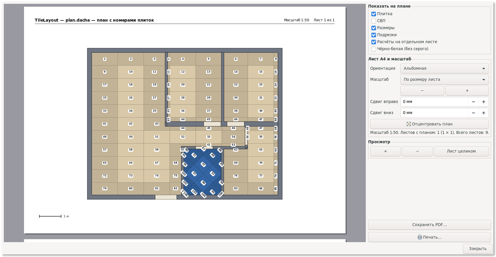
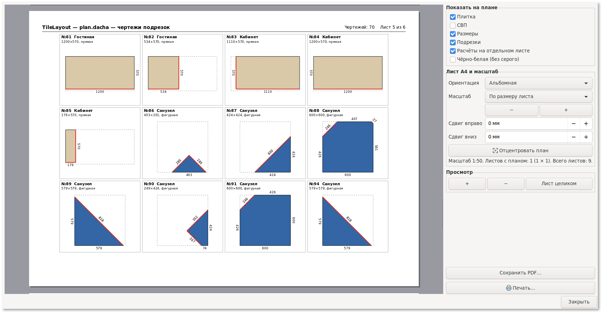
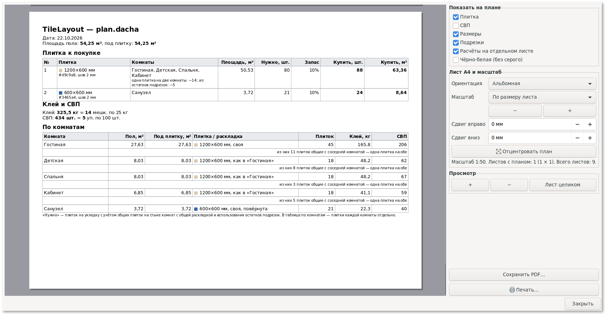

# TileLayout

[](https://github.com/DasRegal/TileLayout/actions/workflows/build.yml)
[](https://github.com/DasRegal/TileLayout/releases/latest)
[](https://github.com/DasRegal/TileLayout/releases)


[](LICENSE)

Программа для раскладки плитки на C99 + GTK 3:
- план дома: стены, перегородки, проёмы;
- точная форма перегородок для раскроя: каждый угол тела задаётся отдельно, торцы срезаются точно по стене или боку другой перегородки;
- комнаты появляются из замкнутых областей; пол под дверью делится между комнатами стыком, который можно сдвигать;
- раскладка плитки, расчёт плитки, клея и СВП;
- деформационные швы: режут плитку с заданным зазором, куски видны на плане с номерами и в чертежах подрезок;
- линейки для измерений: концы притягиваются к углам, серединам, краям и осям стен и к швам плитки;
- автовыравнивание по горизонтали и вертикали и по углам других стен — с пунктирными вспомогательными линиями;
- печать и PDF с чертежами подрезок.

## Скачать

Последняя версия — ссылки ниже всегда ведут на неё:

| Система | Скачать | Как запустить |
|---|---|---|
| Windows 10 и 11, 64 бита | [TileLayout-win64.zip](https://github.com/DasRegal/TileLayout/releases/latest/download/TileLayout-win64.zip) | распаковать архив в любую папку и запустить `tilelayout.exe` — установка не нужна |
| Windows, 32 бита | [TileLayout-win32.zip](https://github.com/DasRegal/TileLayout/releases/latest/download/TileLayout-win32.zip) | так же |
| Ubuntu 20.04+, Linux Mint 20+, Debian 11+ | [TileLayout-linux-amd64.deb](https://github.com/DasRegal/TileLayout/releases/latest/download/TileLayout-linux-amd64.deb) | открыть файл двойным щелчком или `sudo apt install ./TileLayout-linux-amd64.deb`; программа появится в меню |

Все версии — на странице [Releases](https://github.com/DasRegal/TileLayout/releases), что изменилось — в [CHANGELOG.md](CHANGELOG.md). Для других систем программу можно [собрать из исходников](#сборка).

Файлы проектов — `*.tilelayout.json`. Открываются и файлы прежней Python-версии программы.

<p align="center">
  <a href="docs/screenshots/screenshot_main.png"></a>
</p>

<table>
  <tr>
    <td align="center" width="33%"><a href="docs/screenshots/screenshot_conv_1.png"></a><br>План с номерами плиток</td>
    <td align="center" width="33%"><a href="docs/screenshots/screenshot_conv_2.png"></a><br>Чертежи подрезок</td>
    <td align="center" width="33%"><a href="docs/screenshots/screenshot_conv_3.png"></a><br>Лист расчёта</td>
  </tr>
</table>

## Сборка

Нужны компилятор C, CMake 3.13 или новее и GTK 3 для разработки.

```sh
git clone https://github.com/DasRegal/TileLayout.git
cd TileLayout
```

### Linux

Установите зависимости одной командой для своего дистрибутива:

| Дистрибутив | Команда |
|---|---|
| Ubuntu 20.04+, Linux Mint 20+, Debian 11+ | `sudo apt install build-essential cmake pkg-config libgtk-3-dev` |
| Fedora | `sudo dnf install gcc cmake pkgconf-pkg-config gtk3-devel` |
| Arch, Manjaro | `sudo pacman -S --needed base-devel cmake gtk3` |

Сборка, проверка и запуск:

```sh
cmake -S . -B build -DCMAKE_BUILD_TYPE=Release
cmake --build build -j
(cd build && ctest --output-on-failure)
./build/tilelayout [проект.tilelayout.json]
```

С CMake 3.21 и новее можно короче, через пресеты:

```sh
cmake --preset release && cmake --build --preset release && ctest --preset release
```

Есть и пресет `debug` (папка `build-debug`). В VS Code с расширением CMake Tools пресеты появляются в строке состояния.

#### Если `libgtk-3-dev` не устанавливается

Так бывает, когда библиотеки GTK в системе новее, чем у её репозиториев. Например, в Linux Mint 19 с GTK из Ubuntu 20.04 apt пишет «unmet dependencies». Тогда:

```sh
tools/fetch-gtk-dev.sh
```

Скрипт ничего не устанавливает в систему. Он скачивает файлы для разработки ровно под установленную версию GTK в `~/.cache/tilelayout/gtk3-dev`. CMake находит эту папку сам, дальше собирайте командами выше.

Если потом поставите `libgtk-3-dev` обычным способом, CMake возьмёт системный. Папку можно удалить: `rm -rf ~/.cache/tilelayout`.

#### Пакет .deb

После сборки командами выше:

```sh
(cd build && cpack -G DEB)
# результат: build/tilelayout_<версия>_amd64.deb — с ярлыком в меню и значком
```

### Windows (MSYS2, оболочка «MSYS2 MINGW64»)

```sh
pacman -S --needed git mingw-w64-x86_64-toolchain mingw-w64-x86_64-cmake mingw-w64-x86_64-ninja mingw-w64-x86_64-gtk3
cmake -S . -B build -G Ninja -DCMAKE_BUILD_TYPE=Release
cmake --build build
(cd build && ctest --output-on-failure)
./build/tilelayout.exe
```

Для 32-битной Windows — то же в оболочке «MSYS2 MINGW32», с пакетами `mingw-w64-i686-…` вместо `mingw-w64-x86_64-…`, но без `gtk3`. GTK для 32-битной Windows из каталога MSYS2 убран, его ставит скрипт из архива репозитория MSYS2:

```sh
pacman -S --needed git mingw-w64-i686-toolchain mingw-w64-i686-cmake mingw-w64-i686-ninja
packaging/windows/install-mingw32-gtk.sh
```

### Переносная сборка для Windows

Папка и zip, которые запускаются без установки и без MSYS2. Собираются там же, в оболочке MINGW64 (x64) или MINGW32 (x86):

```sh
pacman -S zip mingw-w64-x86_64-librsvg
packaging/windows/make-portable.sh build 1.2
# результат: папка dist/TileLayout-1.2-win64/ и архив dist/TileLayout-win64.zip
```

Скрипт сам находит нужные DLL. Кроме них он кладёт в папку:
- загрузчики значков PNG и SVG;
- схемы настроек GTK;
- символьные значки Adwaita;
- лицензии библиотек.

В конце скрипт проверяет, что программа запускается без MSYS2 в `PATH`.

Переносной режим: если рядом с `tilelayout.exe` лежит `tilelayout.ini`, настройки хранятся в нём. В переносной сборке этот файл уже есть. Без него настройки хранятся в профиле пользователя.

### Только ядро и тесты

Если GTK не найден, CMake выдаёт предупреждение и собирает только ядро и спецификации. Кросс-сборка ядра из Linux под Windows:

```sh
cmake -S . -B build-win -DCMAKE_TOOLCHAIN_FILE=cmake/mingw-w64-x86_64.cmake -DTL_BUILD_APP=OFF
cmake --build build-win && wine64 build-win/tl_specs.exe
```

## Спецификации

```sh
cmake --build build && (cd build && ctest --output-on-failure)
# или подробно:
./build/tl_specs
```

Спецификации описывают поведение ядра. Например:
- «перегородка, замкнувшая область, создаёт комнату»;
- «плитка на стыке двух комнат с общим полом считается один раз».

Набор `spec_storage` открывает проект, сохранённый прежней Python-версией. Он проверяет, что количество плиток, клея и СВП совпадает с её расчётами.

## Релизы на GitHub

Сборку делает GitHub Actions: `.github/workflows/build.yml` в корне репозитория.
- **Каждый push в `main`**: сборка и спецификации на Linux и Windows. Пакеты — zip для Windows x64 и x86, .deb для Linux — прикладываются к запуску (вкладка Actions → запуск → Artifacts).
- **Тег `vX.Y`**: то же самое, а файлы публикуются в Releases: `TileLayout-win64.zip`, `TileLayout-win32.zip`, `TileLayout-linux-amd64.deb`. Имена постоянные — на них ведут ссылки из раздела «Скачать». Текст релиза — раздел этой версии из [CHANGELOG.md](CHANGELOG.md).

Как выпустить версию:
1. Поднимите версию в `project(TileLayout VERSION X.Y ...)` в `CMakeLists.txt`.
2. Добавьте в [CHANGELOG.md](CHANGELOG.md) раздел `## [X.Y] — дата`: что добавлено, изменено, исправлено.
3. Закоммитьте и отправьте:

   ```sh
   git tag vX.Y
   git push origin main vX.Y
   ```

Сборка остановится с ошибкой, если тег не совпадает с версией в `CMakeLists.txt` или в `CHANGELOG.md` нет раздела этой версии. Версию в окне «О программе» CMake тоже берёт из `CMakeLists.txt`.

## Командная строка

```
tilelayout [проект]                               обычный запуск
tilelayout --export-png план.png [проект] [--numbers]
tilelayout --export-pdf листы.pdf [проект] [--mono]
tilelayout --screenshot окно.png [проект]          снимок окна
```

## Устройство

```
src/core/   ядро без GUI: модель, геометрия, раскладка, расчёты, JSON, история
src/app/    интерфейс GTK: окно, канва, инструменты, панель, печать
tests/      спецификации ядра и проект прежней Python-версии для проверки совместимости
tools/      fetch-gtk-dev.sh — GTK для разработки без установки в систему
packaging/  переносная сборка для Windows
cmake/      файл кросс-сборки MinGW
docs/       скриншоты
```

Ядро (`tl_*`) не зависит от GTK. Его можно проверить отдельно и собрать любым компилятором C99.

| Модуль | Назначение |
|---|---|
| `tl_geometry`, `tl_regions` | векторы, многоугольники, отсечение; разбиение плоскости на области (заменяет булевы операции) |
| `tl_outline`, `tl_partition`, `tl_opening`, `tl_band` | сущности плана: контур дома, перегородка, проём, полоса стены |
| `tl_space`, `tl_tile_settings` | комната и настройки плитки |
| `tl_ruler`, `tl_expansion_joint`, `tl_measure_snap` | линейка, деформационный шов и притягивание их концов |
| `tl_align` | автовыравнивание: по направлениям и по опорным точкам |
| `tl_project*` | проект: поиск комнат, связанные стены, узлы перегородок, транзакции правки |
| `tl_layout` | раскладка плитки: куски, подрезки, СВП, клей, раскладка от угла и по центру |
| `tl_report*` | сводка по видам плитки, сквозная нумерация, общие плитки и остатки, карточки подрезок, «Минимум плиток» |
| `tl_json`, `tl_project_io`, `tl_history` | файлы проекта и отмена правок |
| `app_document` | открытый проект: выделение, история, файл, подписчики |
| `app_canvas`, `app_tool_*` | канва и инструменты |
| `app_render`, `app_draw` | одна отрисовка для экрана, PNG, PDF и принтера |
| `app_print*`, `app_sheet` | листы A4, предпросмотр, лист расчёта |
| `app_panel`, `app_window`, `app_config` | панель свойств, главное окно, настройки |

Паттерны:
- **Наблюдатель** — канва, панель и окно подписаны на изменения `AppDocument` и не знают друг о друге.
- **Стратегия** — каждый инструмент канвы — таблица функций `AppTool`.
- **Снимок (Memento)** — `TlHistory` хранит снимки проекта в JSON для отмены и повтора.
- **Транзакция правки** — `tl_project_begin_edit / apply_edit / end_edit` сохраняют привязку перегородок и проёмов к стенам при изменении геометрии.

Правила кода:
- память выделяется через `tl_memory` (при нехватке памяти программа завершается);
- динамические массивы задаются через `TL_ARRAY_DEFINE`;
- у каждой сущности есть пара `*_new` / `*_free`;
- глобальное изменяемое состояние есть только в трёх местах:
  - настройки плитки по умолчанию для новых комнат;
  - режим ч/б печати в `app_draw`;
  - кэш иконок;
- JSON не зависит от локали.

Настройки хранятся в `tilelayout.ini`:
- Linux: `~/.config/TileLayout/`;
- Windows: `%LOCALAPPDATA%\TileLayout\`.

## Лицензия

[MIT](LICENSE): программу можно свободно использовать, изменять и распространять, сохраняя уведомление об авторстве.

Переносная сборка для Windows содержит библиотеки GTK и другие — под их собственными лицензиями (LGPL и другие); их тексты лежат в папке `licenses` внутри архива.

Код написан с помощью Claude (Anthropic).
