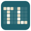
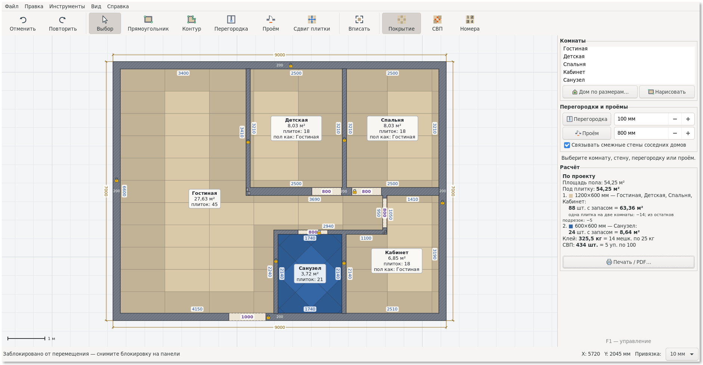
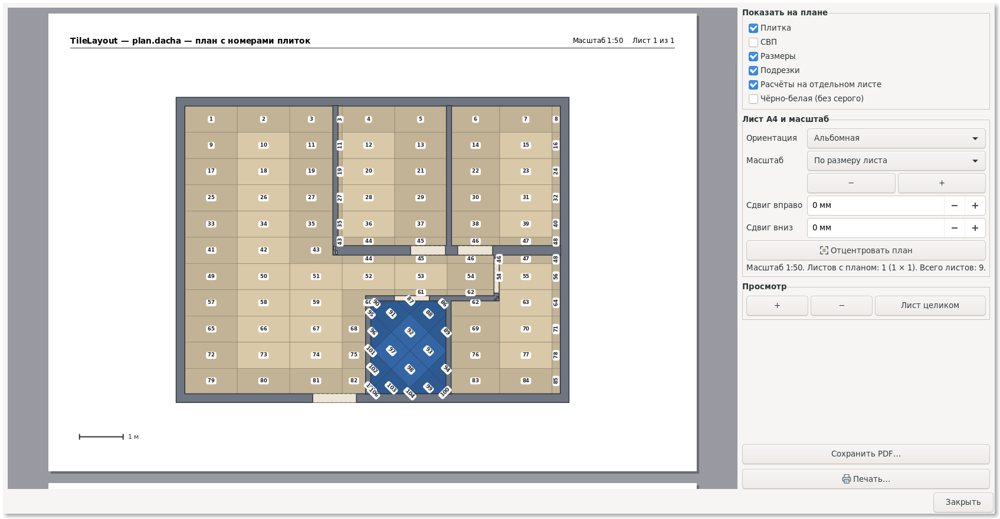
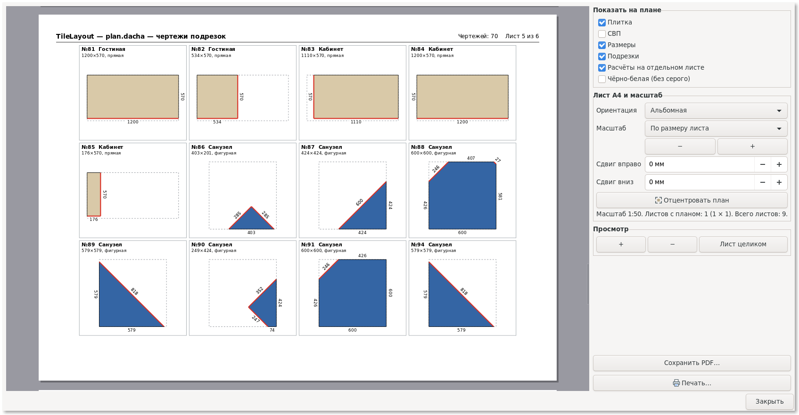
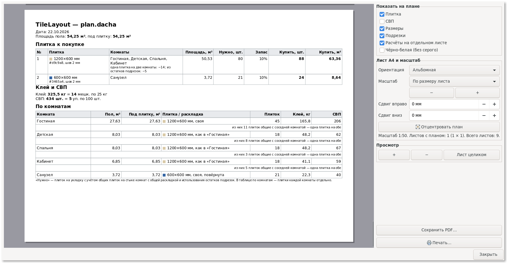

<p align="center">
  
</p>

<h1 align="center">TileLayout</h1>

<p align="center">Раскладка плитки: план дома, расчёт плитки, клея и СВП</p>

<p align="center">
  <a href="https://github.com/DasRegal/TileLayout/actions/workflows/build.yml"></a>
  <a href="https://github.com/DasRegal/TileLayout/releases/latest"></a>
  <a href="https://github.com/DasRegal/TileLayout/releases"></a>
  
  
  <a href="LICENSE"></a>
</p>

<p align="center">
  <a href="https://dasregal.github.io/TileLayout"></a>
</p>

<p align="center">
  <a href="https://github.com/DasRegal/TileLayout/releases/latest/download/TileLayout-win64.zip"></a>
  &nbsp;
  <a href="https://github.com/DasRegal/TileLayout/releases/latest/download/TileLayout-win32.zip"></a>
  &nbsp;
  <a href="https://github.com/DasRegal/TileLayout/releases/latest/download/TileLayout-linux-amd64.deb"></a>
</p>

# Программа для раскладки плитки (C99 + GTK 3)

Инструмент для проектирования помещений, раскладки плитки и точного расчета материалов.

<p align="center">
  <a href="docs/screenshots/screenshot_main.png"></a>
</p>

<table>
  <tr>
    <td align="center" width="33%"><a href="docs/screenshots/screenshot_conv_1.png"></a><br>План с номерами плиток</td>
    <td align="center" width="33%"><a href="docs/screenshots/screenshot_conv_2.png"></a><br>Чертежи подрезок</td>
    <td align="center" width="33%"><a href="docs/screenshots/screenshot_conv_3.png"></a><br>Лист расчёта</td>
  </tr>
</table>

## 🔥 Ключевые возможности

* **Интерактивное 3D:** Выберите комнату — справа вверху плашка «План | Стены | 3D», она же возвращает на план (или Esc). Объемный вид комнаты (пол, стены, проёмы, мебель, лестницы) с рисунками плитки из каталога и отверстиями под трубы; вращение мышью или пальцем, приближение колесом или щипком, сдвиг правой кнопкой или двумя пальцами.
* **Сметный расчет:** Автоматический расчет стоимости материалов и плиточных работ в рублях (укладка за м², подрезка за погонный метр) с отчетом для заказчика.
* **Экспорт в DXF для станков:** Выгрузка многослойных планов и точных чертежей подрезок для ЧПУ.
* **Деформационные швы:** Нарезка плитки с заданным зазором, нумерация кусков на плане и в чертежах подрезок.
* **Зонирование и декор:** Создание бордюров вдоль стен, центрального «ковра» со своим рисунком и художественных панно на полу и стенах.
* **Печать и PDF:** Экспорт готовых отчетов и подробных чертежей подрезок в PDF.

## 🛠 Проектирование и геометрия

* **Гибкий план:** Стены, перегородки и проёмы. Точная подгонка торцов перегородок по стенам.
* **Автогенерация комнат:** Помещения автоматически определяются из замкнутых контуров стен.
* **Умные дверные стыки:** Сдвигаемое разделение напольного покрытия в проёмах (включая наружные двери).
* **Линии раздела:** Деление пола на зоны с разной плиткой (например, душевая из мозаики) или без облицовки.
* **Калиброванная подложка:** Импорт планов в DXF или фото с масштабированием по известному размеру.

## 📐 Режимы раскладки и раскрой

* **Схемы укладки:** Прямая, шахматка, ёлочка, французский шеврон, кабошон (со вставкой), корзинка и модульная из 2–4 форматов (версаль).
* **Позиционирование:** От угла, по центру, от двери, по оси или оптимизация «Минимум плиток».
* **Развертка стен:** Облицовка по сегментам (низ, фриз, основная плитка), свой сдвиг плитки у каждой стены, ряды как у другой стены и синхронизация швов с полом.
* **Трубы и трапы:** Учет отверстий под трубы (с диаметром коронки) и раскладка «конвертом» для точечных трапов.
* **Учет калибра:** Работа с фактическим размером плитки отдельно от номинального.
* **Карта раскроя:** Группировка подрезок для реза стопкой и выкраивание двух деталей из одной плитки; у шеврона — остаток от одного торца в кусок у другого, у плитки с рисунком куски не поворачиваются.
* **Комната в расчёте:** Одной галочкой убрать комнату с плана и из расчёта целиком, не теряя её настроек; «Плитка на полу» — отдельно от стен и участков.

## 💻 Интерфейс и UX

* **Размеры числом:** Касание подписи размера (линейка, проём, длина стены снаружи и внутри, линейка на стене) открывает поле ввода прямо на плане; на телефоне — цифровая клавиатура.
* **Умные линейки:** Привязка к углам, осям стен, плиточным швам, углам проёмов и стыкам в них, к трубам (центр и края), предметам и трапам. Линейки держатся за то, к чему привязаны, и двигаются вместе с ним; длина, введённая числом, сдвигает трубу, предмет или проём на конце линейки. На мелком масштабе подписи коротких линеек скрываются.
* **Автовыравнивание:** Привязка по осям и углам смежных стен с динамическими направляющими.
* **Пакетная настройка:** Быстрое изменение параметров сразу для нескольких комнат через `Shift + клик`.
* **Автономные ссылки:** Проект полностью кодируется в URL-ссылку, которая открывается без сервера на сайте или в программе. Рисунки плитки передаются ссылкой на каталог: встроенные видны и на сайте, а из своих каталогов программы — только у вас (на сайте — цвет плитки; программа предупредит при отправке).
* **Тёмная тема:** Включена по умолчанию — серо-фиолетовая, в духе Dracula; светлая — кнопкой на сайте и в программе («Вид → Тёмная тема», Ctrl+Shift+D). В программе тёмным становится всё окно, плитка, стены и подписи остаются хорошо видны; печать и PDF — всегда светлые.
* **Аккуратная панель:** На виду — плитка и раскладка комнаты; подрезка и запас, материалы, гидроизоляция, цены, бордюр и ковёр — в отдельных окнах, на кнопках видна краткая сводка.

## Скачать

Последняя версия — ссылки ниже всегда ведут на неё:

| Система | Скачать | Как запустить |
|---|---|---|
| Windows 10 и 11, 64 бита | [TileLayout-win64.zip](https://github.com/DasRegal/TileLayout/releases/latest/download/TileLayout-win64.zip) | распаковать архив в любую папку и запустить `tilelayout.exe` — установка не нужна |
| Windows, 32 бита | [TileLayout-win32.zip](https://github.com/DasRegal/TileLayout/releases/latest/download/TileLayout-win32.zip) | так же |
| Ubuntu 20.04+, Linux Mint 20+, Debian 11+ | [TileLayout-linux-amd64.deb](https://github.com/DasRegal/TileLayout/releases/latest/download/TileLayout-linux-amd64.deb) | открыть файл двойным щелчком или `sudo apt install ./TileLayout-linux-amd64.deb`; программа появится в меню |

**В браузере, без установки:** https://dasregal.github.io/TileLayout/ — см. [Веб-версия](#веб-версия).

Все версии — на странице [Releases](https://github.com/DasRegal/TileLayout/releases), что изменилось — в [CHANGELOG.md](CHANGELOG.md). Для других систем программу можно [собрать из исходников](#сборка).

## Каталоги плитки

Плитку комнаты можно взять из каталога: меню **Плитка → Выбрать из каталога…** (Ctrl+K) или кнопка
«Выбрать…» в строке «Рисунок» на панели. Плитка задаёт комнате размер и рисунок; на плане и при печати
плитки рисуются этим рисунком. «Только цвет» убирает рисунок. В файле проекта у плитки — ссылка
`"texture": "каталог/плитка"`; если такого каталога на компьютере нет, плитка рисуется цветом.

Каждая папка с плитками — отдельный каталог. Встроенный — «Образцы TileLayout», 56 плиток с
рисунками, сделанными программно (`tools/make-sample-catalog.py`): разные материалы и ходовые форматы
из магазинов — керамогранит 60×60, 60×120, 80×80, 30×60, 30×30, «паркет» 20×120, 20×60, 15×60,
20×80, напольная 33×33–45×45, настенная 20×30, 25×40, 20×60, 30×60, 25×75, 30×90, 15×15,
«кабанчик» 7,5×15–10×30, мозаика 30×30, «ёлочка» Chevron Light 60×120. Размеры
номинальные: калибр у производителей отличается на несколько миллиметров (40,2×40,2, 29,8×59,8) —
сверьте с упаковкой.

Свои каталоги кладите в папку своих каталогов (**Плитка → Папка своих каталогов**):

- Linux — `~/.local/share/TileLayout/catalogs/`
- Windows — `%LOCALAPPDATA%\TileLayout\catalogs\`

**Проще всего** — картинки с размером в имени: `Мрамор Каррара 600x300.jpg` (между числами `x`, `х`
или `×`; размер — в мм, длина × ширина). Название плитки — имя файла без размера. Подходят JPEG и PNG.

**С описанием** — файл `catalog.json` в папке каталога:

```json
{
 "name": "Мои ступени",
 "tiles": [
  {"id": "stone-grey", "name": "Камень серый", "width": 600, "height": 300,
   "image": "stone-grey.jpg", "color": "#8a8780"}
 ]
}
```

`id` (по умолчанию — имя файла) и `color` (по умолчанию — средний цвет рисунка) необязательны.

**Разделы** — вложенные папки любой глубины, например по фирмам и форматам:

```
catalogs/
  Фирмы/
    Фабрика Север/
      60×120/
        Мрамор белый 1200x600.jpg
      30×60/
        Оникс 600x300.jpg
    Фабрика Юг/
      Chevron Light 1200x600.jpg
```

В окне выбора слева — дерево: каталог, его разделы и подразделы, у каждого — число плиток; выбор
раздела показывает его плитки вместе с вложенными. Каждая папка описывается так же — картинками или
своим `catalog.json`. В файле проекта ссылка включает путь: `"Фирмы/Фабрика Север/60×120/Мрамор
белый 1200x600"` — если перенести плитку в другую папку, комнаты с ней будут рисоваться цветом.

После добавления файлов — **Плитка → Обновить каталоги** или кнопка «Обновить» в окне выбора.

## Веб-версия

https://dasregal.github.io/TileLayout/ — то же ядро, собранное в WebAssembly, в любом современном браузере,
в том числе на телефоне. Сейчас в ней:
- открыть файл проекта настольной программы (кнопкой или перетащив файл на страницу) и сохранить его обратно;
- рисовать план: дом прямоугольником или контуром, комнату внутри дома, перегородку, проём — с теми же
  привязками к углам, граням стен и сетке, что у программы; толщина перегородки и стены, ширина проёма, удаление;
- перетаскивать: угол дома, стену (параллельно себе), перегородку (за середину — поперёк, за конец — длина и
  поворот, за угол тела — толщина у конца; длина, угол и толщина — и полями на панели), узел и примыкание перегородок, проём вдоль стены, стык полов в проёме, дом целиком (за выделенную
  комнату), сетку плитки (с Ctrl) — так же, как в программе;
- деформационные швы и линейки — с притягиванием концов к стенам и швам плитки;
- по числам на панели: длина стены (внутр./наружн., с сохранением углов), координаты угла дома и узла,
  проём от краёв стены, стык полов в проёме, блокировка от перемещения; новый угол — двойным щелчком по
  стене, «Дом по размерам…»;
- общий пол с другой комнатой (одна сетка плитки), «Длина ⇄ ширина» плитки;
- план с раскладкой, стенами, проёмами и размерами; масштаб колесом мыши или двумя пальцами;
- плитка комнаты: размеры, шов, рисунок укладки (прямая, шахматка, ёлочка, шеврон, со вставкой, корзинка,
  модульная), бордюр вдоль стен и ковёр в центре, облицовка стен (низ, фриз, плитка стен) с развёрткой во
  комнате (кнопка «Стены»), поворот, смещение,
  раскладка от угла, по центру, от двери и по линейке, «Минимум плиток», плитка из каталога с рисунком,
  название комнаты;
- трубы (H): отверстия в плитке — в чертежах подрезок;
- несколько комнат сразу (Shift + щелчок, на телефоне — кнопка «Несколько комнат»): плитка, клей и СВП
  меняются у всех; поле с разными значениями пустое — «разные»;
- на телефоне план — на весь экран, настройки и расчёт — в шторке снизу;
- расчёт к покупке: плитка с запасом, клей, СВП, затирка, грунт; смета по ценам комнат;
- печать и PDF (через печать браузера): план в масштабе 1:N на листах A4, план с номерами плиток, чертежи
  подрезок, лист расчёта; меню «Экспорт» — картинка плана PNG, план и подрезки в DXF; меню «Вид» — плитка,
  номера, размеры, СВП, подписи, швы, линейки;
- подложка: фото или DXF плана квартиры под планом, калибровка масштаба по известному размеру;
- 3D-вид комнаты (кнопка «3D» справа вверху): тянуть пальцем или мышью — повернуть;
- отмена и повтор (Ctrl+Z, Ctrl+Shift+Z); клавиши инструментов V, R, C, P, O, J (шов), H (труба), L (линейка);
  Delete — удалить выделенное.

Пока только в настольной программе: свои каталоги плитки (сайт не читает папки компьютера).

Сервера у сайта нет: проект открывается с компьютера пользователя, считается в его браузере и сохраняется
файлом к нему же; последний проект запоминается в этом браузере. Пользователи друг другу не мешают и не
видят чужих проектов. После первого захода сайт работает и без интернета (он целиком сохраняется в
браузере), его можно установить как приложение — на телефоне «На главный экран».

Сайт собирается и публикуется на GitHub Pages сам — `.github/workflows/web.yml` при каждом пуше в `main`
(один раз в настройках репозитория: **Settings → Pages → Source: GitHub Actions**). Собрать вручную — нужен
[Emscripten](https://emscripten.org/docs/getting_started/downloads.html):

```sh
web/build.sh dist/web
python3 -m http.server -d dist/web 8000   # http://localhost:8000
```

## Сборка

Нужны компилятор C, CMake 3.13 или новее и GTK 3 для разработки.

```sh
git clone https://github.com/DasRegal/TileLayout.git
cd TileLayout
```

### Linux

Установите зависимости одной командой для своего дистрибутива:

| Дистрибутив | Команда |
|---|---|
| Ubuntu 20.04+, Linux Mint 20+, Debian 11+ | `sudo apt install build-essential cmake pkg-config libgtk-3-dev` |
| Fedora | `sudo dnf install gcc cmake pkgconf-pkg-config gtk3-devel` |
| Arch, Manjaro | `sudo pacman -S --needed base-devel cmake gtk3` |

Сборка, проверка и запуск:

```sh
cmake -S . -B build -DCMAKE_BUILD_TYPE=Release
cmake --build build -j
(cd build && ctest --output-on-failure)
./build/tilelayout [проект.tilelayout.json]
```

С CMake 3.21 и новее можно короче, через пресеты:

```sh
cmake --preset release && cmake --build --preset release && ctest --preset release
```

Есть и пресет `debug` (папка `build-debug`). В VS Code с расширением CMake Tools пресеты появляются в строке состояния.

#### Если `libgtk-3-dev` не устанавливается

Так бывает, когда библиотеки GTK в системе новее, чем у её репозиториев. Например, в Linux Mint 19 с GTK из Ubuntu 20.04 apt пишет «unmet dependencies». Тогда:

```sh
tools/fetch-gtk-dev.sh
```

Скрипт ничего не устанавливает в систему. Он скачивает файлы для разработки ровно под установленную версию GTK в `~/.cache/tilelayout/gtk3-dev`. CMake находит эту папку сам, дальше собирайте командами выше.

Если потом поставите `libgtk-3-dev` обычным способом, CMake возьмёт системный. Папку можно удалить: `rm -rf ~/.cache/tilelayout`.

#### Пакет .deb

После сборки командами выше:

```sh
(cd build && cpack -G DEB)
# результат: build/tilelayout_<версия>_amd64.deb — с ярлыком в меню и значком
```

### Windows (MSYS2, оболочка «MSYS2 MINGW64»)

```sh
pacman -S --needed git mingw-w64-x86_64-toolchain mingw-w64-x86_64-cmake mingw-w64-x86_64-ninja mingw-w64-x86_64-gtk3
cmake -S . -B build -G Ninja -DCMAKE_BUILD_TYPE=Release
cmake --build build
(cd build && ctest --output-on-failure)
./build/tilelayout.exe
```

Для 32-битной Windows — то же в оболочке «MSYS2 MINGW32», с пакетами `mingw-w64-i686-…` вместо `mingw-w64-x86_64-…`, но без `gtk3`. GTK для 32-битной Windows из каталога MSYS2 убран, его ставит скрипт из архива репозитория MSYS2:

```sh
pacman -S --needed git mingw-w64-i686-toolchain mingw-w64-i686-cmake mingw-w64-i686-ninja
packaging/windows/install-mingw32-gtk.sh
```

### Переносная сборка для Windows

Папка и zip, которые запускаются без установки и без MSYS2. Собираются там же, в оболочке MINGW64 (x64) или MINGW32 (x86):

```sh
pacman -S zip mingw-w64-x86_64-librsvg
packaging/windows/make-portable.sh build 1.2
# результат: папка dist/TileLayout-1.2-win64/ и архив dist/TileLayout-win64.zip
```

Скрипт сам находит нужные DLL. Кроме них он кладёт в папку:
- загрузчики значков PNG и SVG;
- схемы настроек GTK;
- символьные значки Adwaita;
- лицензии библиотек.

В конце скрипт проверяет, что программа запускается без MSYS2 в `PATH`.

Переносной режим: если рядом с `tilelayout.exe` лежит `tilelayout.ini`, настройки хранятся в нём. В переносной сборке этот файл уже есть. Без него настройки хранятся в профиле пользователя.

### Только ядро и тесты

Если GTK не найден, CMake выдаёт предупреждение и собирает только ядро и спецификации. Кросс-сборка ядра из Linux под Windows:

```sh
cmake -S . -B build-win -DCMAKE_TOOLCHAIN_FILE=cmake/mingw-w64-x86_64.cmake -DTL_BUILD_APP=OFF
cmake --build build-win && wine64 build-win/tl_specs.exe
```

## Спецификации

```sh
cmake --build build && (cd build && ctest --output-on-failure)
# или подробно:
./build/tl_specs
```

Спецификации описывают поведение ядра. Например:
- «перегородка, замкнувшая область, создаёт комнату»;
- «плитка на стыке двух комнат с общим полом считается один раз».

Набор `spec_storage` открывает проект, сохранённый прежней Python-версией, а `spec_summary` сверяет расчёт с
её цифрами. Отличия объяснены в самих спецификациях: пол под дверью тоже кладут плиткой, а в пары остатков
идут и угловые куски — Python-версия их не учитывала.

## Релизы на GitHub

Сборку делает GitHub Actions: `.github/workflows/build.yml` в корне репозитория.
- **Каждый push в `main`**: сборка и спецификации на Linux и Windows. Пакеты — zip для Windows x64 и x86, .deb для Linux — прикладываются к запуску (вкладка Actions → запуск → Artifacts).
- **Тег `vX.Y`**: то же самое, а файлы публикуются в Releases: `TileLayout-win64.zip`, `TileLayout-win32.zip`, `TileLayout-linux-amd64.deb`. Имена постоянные — на них ведут ссылки из раздела «Скачать». Текст релиза — раздел этой версии из [CHANGELOG.md](CHANGELOG.md).

Как выпустить версию:
1. Поднимите версию в `project(TileLayout VERSION X.Y ...)` в `CMakeLists.txt`.
2. Добавьте в [CHANGELOG.md](CHANGELOG.md) раздел `## [X.Y] — дата`: что добавлено, изменено, исправлено.
3. Закоммитьте и отправьте:

   ```sh
   git tag vX.Y
   git push origin main vX.Y
   ```

Сборка остановится с ошибкой, если тег не совпадает с версией в `CMakeLists.txt` или в `CHANGELOG.md` нет раздела этой версии. Версию в окне «О программе» CMake тоже берёт из `CMakeLists.txt`.

## Командная строка

```
tilelayout [проект]                               обычный запуск
tilelayout --export-png план.png [проект] [--numbers]
tilelayout --export-pdf листы.pdf [проект] [--mono]
tilelayout --screenshot окно.png [проект]          снимок окна
```

## Устройство

```
src/core/   ядро без GUI: модель, геометрия, раскладка, расчёты, JSON, история
src/app/    интерфейс GTK: окно, канва, инструменты, панель, печать
src/web/    ядро для веб-версии: проект, сцена и расчёт строками JSON; список каталогов для сайта
web/        страница веб-версии: план на Canvas, панель, каталог, файлы (JavaScript без зависимостей)
tests/      спецификации ядра и проект прежней Python-версии для проверки совместимости
tools/      fetch-gtk-dev.sh — GTK для разработки без установки в систему
packaging/  переносная сборка для Windows
cmake/      файл кросс-сборки MinGW
docs/       скриншоты
```

Ядро (`tl_*`) не зависит от GTK. Его можно проверить отдельно и собрать любым компилятором C99.

| Модуль | Назначение |
|---|---|
| `tl_geometry`, `tl_regions` | векторы, многоугольники, отсечение; разбиение плоскости на области (заменяет булевы операции) |
| `tl_outline`, `tl_partition`, `tl_opening`, `tl_band` | сущности плана: контур дома, перегородка, проём, полоса стены |
| `tl_space`, `tl_tile_settings` | комната (высота, облицовка стен) и настройки плитки |
| `tl_wall`, `tl_space_walls` | облицовка стен: полосы (низ, фриз, основная плитка), развёртка стен комнаты с проёмами, раскладка на каждую полосу каждой стены |
| `tl_pattern` | рисунки укладки: модуль плиток (прямоугольники или многоугольники) и решётка; новый рисунок — функция модуля и строка в таблице |
| `tl_zone`, `tl_space_zones` | зоны пола: бордюр вдоль стен (раскладка на каждую стену), ковёр в центре |
| `tl_pipe` | отверстия под трубы |
| `tl_estimate` | смета в рублях по сводному расчёту |
| `tl_ruler`, `tl_expansion_joint`, `tl_measure_snap`, `tl_measure_anchor` | линейка, деформационный шов, притягивание их концов и привязка концов к стенам при правке |
| `tl_align` | автовыравнивание: по направлениям и по опорным точкам |
| `tl_project*` | проект: поиск комнат, связанные стены, узлы перегородок, транзакции правки |
| `tl_layout`, `tl_layout_align` | раскладка поверхности (пол комнаты, зона, полоса стены) по рисунку: куски, подрезки, отверстия, СВП, клей, затирка, грунт; от угла, по центру, от двери, по линии |
| `tl_report*` | сводка по видам плитки, сквозная нумерация, общие плитки и остатки, карточки подрезок, «Минимум плиток» |
| `tl_json`, `tl_project_io`, `tl_history` | файлы проекта и отмена правок |
| `tl_drag` | перетаскивание углов, стен, домов, перегородок, узлов, примыканий, проёмов, стыков, линеек, швов и сетки плитки — общее для программы и сайта |
| `tl_snap`, `tl_project_commands` | привязки курсора; добавление контура (дом или комната), перегородки, проёма — общие для программы и сайта |
| `tl_catalog*` | каталоги плитки: описание, имена файлов с размером, обход папок через `TlCatalogSource` (диск, сайт) |
| `tl_web*` | веб-версия (в том числе `tl_web_print` — номера плиток и чертежи подрезок для печати): открытый проект и обмен с JavaScript строками JSON; собирается и обычным компилятором — его проверяют спецификации |
| `app_document` | открытый проект: выделение, история, файл, подписчики |
| `app_canvas`, `app_tool_*` | канва и инструменты |
| `app_render`, `app_draw` | одна отрисовка для экрана, PNG, PDF и принтера |
| `app_print*`, `app_sheet` | листы A4, предпросмотр, лист расчёта |
| `app_panel`, `app_window`, `app_config` | панель свойств, главное окно, настройки |

Паттерны:
- **Наблюдатель** — канва, панель и окно подписаны на изменения `AppDocument` и не знают друг о друге.
- **Стратегия** — каждый инструмент канвы — таблица функций `AppTool`.
- **Снимок (Memento)** — `TlHistory` хранит снимки проекта в JSON для отмены и повтора.
- **Транзакция правки** — `tl_project_begin_edit / apply_edit / end_edit` сохраняют привязку перегородок и проёмов к стенам при изменении геометрии.

Правила кода:
- память выделяется через `tl_memory` (при нехватке памяти программа завершается);
- динамические массивы задаются через `TL_ARRAY_DEFINE`;
- у каждой сущности есть пара `*_new` / `*_free`;
- глобальное изменяемое состояние есть только в четырёх местах:
  - настройки плитки по умолчанию для новых комнат;
  - режим ч/б печати в `app_draw`;
  - кэш иконок;
  - открытый проект веб-версии (`tl_web`: у страницы один проект);
- JSON не зависит от локали.

Настройки хранятся в `tilelayout.ini`:
- Linux: `~/.config/TileLayout/`;
- Windows: `%LOCALAPPDATA%\TileLayout\`.

## Лицензия

[GNU AGPL 3.0](LICENSE), начиная с версии 1.25.1:

* **Для себя:** программой и сайтом можно свободно пользоваться, изменять и распространять их.
* **Условие:** кто распространяет изменённую программу или даёт пользоваться ею через сеть (например, встраивает раскладку в свой сайт), обязан открыть её исходный код целиком под той же лицензией.
* **Коммерческая лицензия:** магазинам и компаниям, которые хотят встроить раскладку в свой сайт или продукт без открытия кода, — отдельная платная лицензия. Пишите на minuscreets@gmail.com.

Версии до 1.25 включительно выпущены под лицензией MIT и остаются под ней.

Переносная сборка для Windows содержит библиотеки GTK и другие — под их собственными лицензиями (LGPL и другие); их тексты лежат в папке `licenses` внутри архива.

Код написан с помощью Claude (Anthropic).
